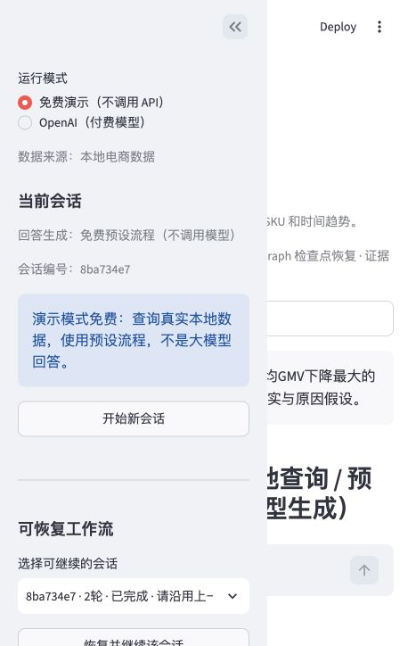
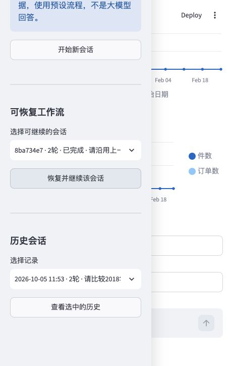
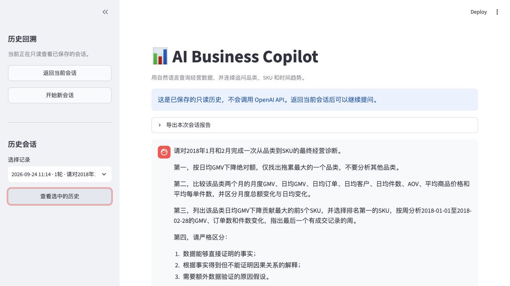
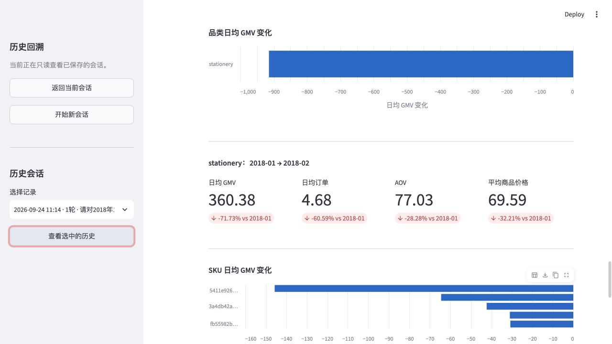
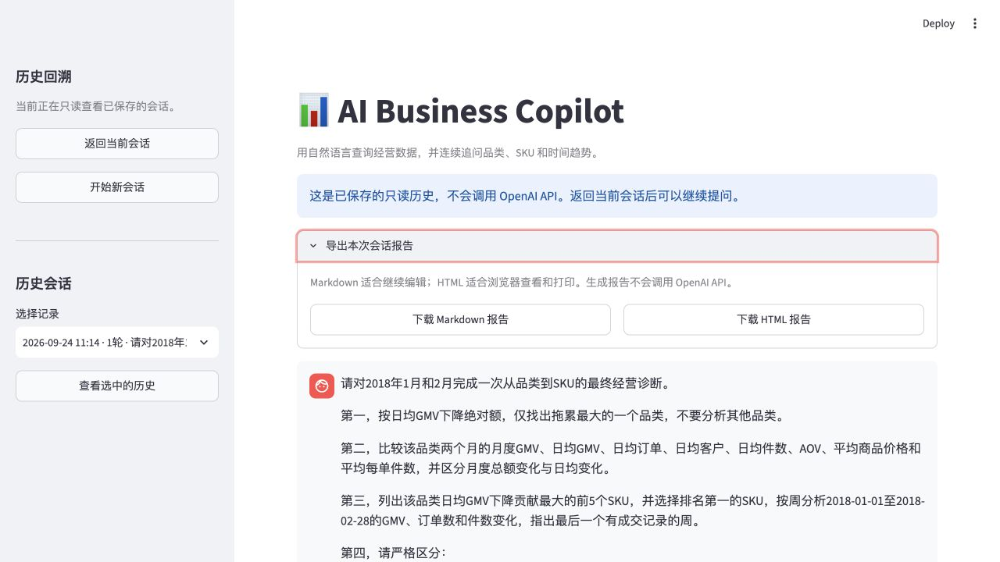
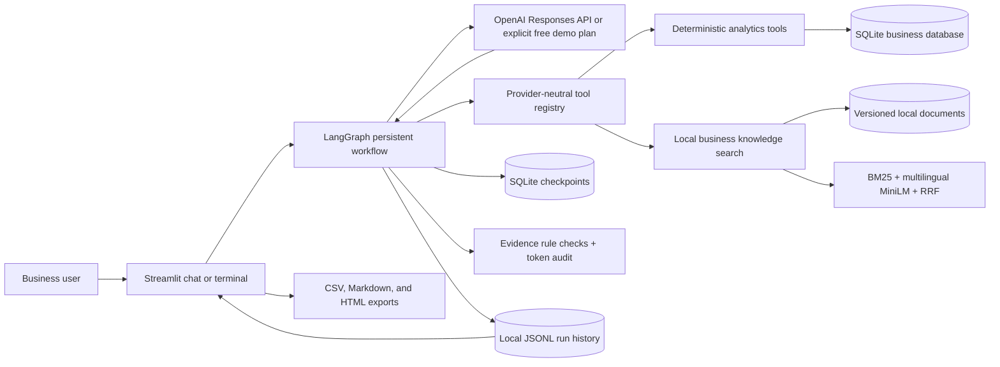

# AI Business Copilot

[](https://github.com/qNaoNao/ai-business-copilot/actions/workflows/ci.yml)

An evidence-based business analytics agent that turns natural-language questions
into auditable analysis over a local SQLite database.

The project combines deterministic SQL analytics, versioned local business RAG,
a persistent LangGraph tool-calling workflow, multi-turn conversations, charts,
run audits, and downloadable reports. Free demo and paid model modes are explicitly
separated; the demo executes real SQL with a fixed plan, not a simulated LLM.

The governed analysis workbench adds a shared metric catalog, composable queries,
inspectable parameterized SQL, persistent analysis snapshots and review feedback.
A token-protected metrics API exposes the same query engine without model fees.

> **Status (2026-10-17):** local, single-agent application with public source code.
> 105 automated tests passed locally. Check the latest workflow run for cloud
> acceptance of the workbench/API changes. Prior API-free CI passed for commit
> `01e58f8` on 2026-10-06. Docker configuration is supplied but its runtime has
> not been validated locally (Docker engine unavailable). No public deployment.
> [View workflow runs](https://github.com/qNaoNao/ai-business-copilot/actions/workflows/ci.yml).

## Governed analytics workbench

Choose **工作区 → 数据探索与分析资产** in the sidebar. No model key is required.

- Combine **9 approved metrics** and **5 dimensions** (up to two per query).
- Preview SQL and bound parameters before execution. Free-form SQL is not accepted.
- Enforce source-key uniqueness, read-only authorization, row/date/VM/time limits.
- Inspect metric definitions, query plans, catalog version and source fingerprint.
- Save immutable result snapshots; reload without querying or replay against current
  data with explicit source/catalog/result-change flags.
- Add append-only manual reviews and inspect local query success/error counts.
- Export query evidence as JSON and data as formula-escaped CSV.
- Integrate through a separate analyst/viewer-token HTTP API; no paid-model endpoints.

The agent can call the same engine through `query_business_metrics`, its seventh
registered tool. Paid-model selection is tested with simulated responses, not a
new claim about live model accuracy. The manual workbench is fully API-free.

Read [product design, API, deployment and acceptance](docs/PRODUCT_3.0.md).

## Engineering upgrade

- **Real graph persistence:** retrieve → model/plan → validated tools → model →
  evidence checks. SQLite checkpoints preserve completed nodes and selected
  entities across process restarts; unfinished turns can be resumed in the UI.
- **Local hybrid RAG:** Chinese/English BM25 + multilingual MiniLM embeddings,
  reciprocal-rank fusion, document chunks, content-version hashes and citations.
  Missing/stale vector indexes visibly fall back to BM25; model download is explicit.
- **Bounded paid execution:** up to 6 model requests and 6 tool calls per turn;
  3500 output-token limit per request, timeout and no automatic SDK retries.
  Budget exhaustion retains partial evidence instead of discarding the analysis.
- **Auditability:** input/output/cached tokens, tool latency, citation checks,
  currency/causality pattern checks and advisory numeric checks accompany reports.
  Cost estimates are unknown until three model-specific prices are configured.
- **Reproducibility:** a synthetic SQL dataset supports clean-checkout demos,
  isolated workflow recovery tests, Streamlit acceptance and API-free CI.

Read [upgrade, test evidence and boundaries](docs/ENGINEERING_UPGRADE.md) and
[runtime and reproduction guide](docs/HANDOFF_2.0.md).

The upgrade remains local. Default free mode, persistent recovery, citation audit
and charts can be exercised without an API key; the screenshots below include
both the original model acceptance and the new explicitly labelled free demo.

## Why this project exists

Business users often know the question they want to answer but not the SQL,
metric definitions, or analytical sequence required to answer it. A general
language model can explain data fluently, but it should not invent figures or
claim unsupported causes.

AI Business Copilot separates those responsibilities:

- deterministic Python tools calculate numeric facts from SQLite;
- a local knowledge base supplies metric definitions and evidence rules;
- the model selects tools, connects results across turns, and communicates the
  analysis;
- every tool call and result remains inspectable and exportable.

## Key capabilities

- **Natural-language analytics:** ask questions in Chinese or English.
- **Autonomous tool selection:** the agent chooses the smallest relevant tool
  and can call several tools across an analysis.
- **Fair month comparison:** reports both monthly totals and calendar-day-
  normalized metrics when month lengths differ.
- **Category-to-SKU drill-down:** finds the largest category contribution and
  continues to the product_id level.
- **Time-trend diagnosis:** analyzes an exact category or SKU by day or
  Monday-based week, including zero-filled and partial periods.
- **Evidence boundaries:** distinguishes observed facts, non-causal
  interpretations, and hypotheses that require more data.
- **Multi-turn memory:** follow-up questions can refer to entities discovered in
  earlier turns.
- **Interactive local UI:** Streamlit chat, KPI cards, contribution bars,
  trend charts, tool details, and CSV downloads.
- **Auditable history:** every turn is stored locally as JSON Lines and grouped
  into read-only historical sessions.
- **Report export:** any visible conversation can be downloaded as editable
  Markdown or a printable standalone HTML report.
- **API-free acceptance checks:** a deterministic evaluation suite protects the
  most important business answers without spending model credits.

## Example workflow

First question:

```text
请找出2018年1月至2月日均GMV下降最大的品类，并找出该品类中
下降贡献最大的SKU。请严格区分数据事实和原因假设。
```

Follow-up question in the same session:

```text
请沿用上一轮结果，按周分析这个SKU的GMV、订单数和件数变化，
并指出最后一个有成交记录的周。
```

The agent can resolve “这个SKU” from the previous turn, query its weekly
trend, and explain that zero delivered-order sales do not by themselves prove
a stockout or delisting.

## Product screenshots

### Engineering upgrade: free demo and checkpoint recovery

The UI labels demo answers explicitly, keeps graph conversations recoverable,
and includes knowledge-version citations and execution audits. The screenshots
below show the workflow controls and recovered weekly-trend analysis.





### End-to-end business diagnosis

The local Streamlit interface lets a business user submit a multi-step
diagnostic question and revisit a saved result without making another API call.



### Analytics visualizations

Deterministic tool outputs are converted into category contribution charts,
KPI comparison cards, and SKU-level decline visualizations.



### History and report export

Saved conversations can be reviewed locally and exported as editable Markdown
or a standalone HTML report.



## Architecture



The analytics layer does not depend on an agent framework. `src/tools/registry.py`
exposes JSON-compatible tool definitions and a single execution entry point,
while the persistent model-facing workflow lives separately in `src/workflow.py`.
`src/agent.py` retains the original paid terminal loop for backwards compatibility;
the UI uses the new graph, and `python -m src.workflow` is the new persistent CLI.

## Available tools

| Tool | Purpose |
|---|---|
| `query_business_metrics` | Validated metric/dimension intent compiled into bounded, read-only SQL; returns a versioned evidence packet |
| `get_monthly_kpis` | Monthly totals, daily-normalized performance, AOV, item price, and freight share |
| `get_category_contribution` | Largest category growth or decline by daily GMV contribution |
| `compare_category` | Total and daily-normalized drivers for one category across two months |
| `get_category_sku_contribution` | Largest product_id-level growth or decline inside one category |
| `get_entity_time_trend` | Zero-filled daily or weekly trend for one category or SKU |
| `search_business_knowledge` | KPI definitions, comparison rules, data limitations, and evidence boundaries |

## Metric definitions

All business metrics use delivered orders from the prepared local database.

| Metric | Definition |
|---|---|
| GMV | Sum of item value, excluding freight |
| Orders | Distinct delivered orders |
| Customers | Distinct `customer_unique_id` values |
| Items | Number of delivered order items |
| AOV | `GMV / orders` |
| Average items per order | `items / orders` |
| Average item price | `GMV / items` |
| Freight share of total paid | `freight / (GMV + freight)` |
| Daily metrics | Monthly value divided by calendar days in that month |

## Evidence and data boundaries

The current dataset does **not** provide product names, formal SKU codes,
inventory snapshots, product listing logs, site traffic, conversion rate,
promotion flags, costs, margin, or marketing-channel performance.

Consequently:

- `product_id` is the only available SKU-level identifier;
- `not_sold_in_compare_month` means no items appeared in delivered-order data
  for that month;
- zero sales do not prove that a product was out of stock, delisted, or
  discontinued;
- a lower average item price does not prove that the business deliberately
  discounted products;
- order or customer decline must not be renamed “traffic decline” without
  traffic data;
- the dataset has no currency metadata, so monetary values must remain
  currency-neutral rather than being labeled as yuan, RMB, USD, BRL, or with
  a currency symbol;
- exact internal source-table names, source-field names, systems, data owners,
  departments, or responsible people must not be claimed unless a tool
  explicitly provides them;
- additional data categories and potentially relevant business functions may
  be suggested, but they must be labeled as suggestions rather than known facts;
- management recommendations must connect to observed evidence and label
  unverified causes as hypotheses;
- the agent must not promise follow-up work that its registered tools cannot
  perform or end with a generic unsupported offer.

These rules live in `knowledge_base/business_rules.json` and are also reinforced
in the agent instructions.

## Project structure

```text
ai-business-copilot/
├── app.py                         # Streamlit chat application
├── docs/
│   └── images/                    # README product screenshots
├── evals/
│   └── cases.json                 # API-free acceptance cases and expected facts
├── knowledge_base/
│   └── business_rules.json        # KPI definitions and evidence rules
├── notebooks/
│   └── 01_data_exploration.ipynb
├── src/
│   ├── agent.py                   # Responses API multi-turn tool loop
│   ├── database.py                # SQLite connection helper
│   ├── demo_data.py               # Non-overwriting synthetic database bootstrap
│   ├── retrieval.py               # Versioned BM25 / local vectors / RRF
│   ├── retrieval_evals.py         # Keyword/BM25/hybrid comparison
│   ├── evidence.py                # Limited rule-based answer checks
│   ├── workflow.py                # Persistent LangGraph loop and recovery
│   ├── offline_evals.py           # Deterministic acceptance runner
│   ├── report_export.py           # Markdown and standalone HTML reports
│   ├── run_history.py             # Local JSONL persistence and history loading
│   ├── ui_helpers.py              # CSV preparation
│   ├── ui_visualizations.py       # Chart and KPI-card preparation
│   └── tools/
│       ├── business_analytics.py  # Monthly, category, and SKU analytics
│       ├── knowledge_base.py      # Retrieval adapter and keyword baseline
│       ├── registry.py            # Tool schemas and execution registry
│       └── time_trends.py         # Daily and weekly entity trends
├── tests/                         # Unit, integration, UI-helper, and export tests
├── .env.example
├── .gitignore
└── requirements.txt
```

The prepared SQLite database is expected under
`data/processed/business.db`. Data files, API credentials, and local run history
are intentionally excluded from Git.

## Quick start

### 1. Create an isolated Python environment

Python 3.11 is recommended.

```bash
python3.11 -m venv .venv
source .venv/bin/activate
```

### 2. Install dependencies

From the project root:

```bash
python -m pip install -r requirements.lock.txt
```

### 3. Choose data (no API key needed for a demo)

Your private database at `data/processed/business.db` is used by default.
For a clean checkout, create a small, labelled synthetic dataset:

```bash
python -m src.demo_data
export BUSINESS_DB_PATH="$PWD/.demo/business.db"
```

The bootstrap refuses to overwrite an existing database. The Streamlit UI also
falls back to this synthetic fixture automatically when no private DB is present.
It does not claim synthetic business numbers are real customer/company results.

### 4. Optional local vector index

```bash
python -m src.retrieval --build
```

This downloads a multilingual ONNX model once and embeds documents locally;
it does not call a paid model API. No index/model is committed to Git.
Without this step, retrieval runs in clearly labelled BM25 fallback mode.

### 5. Optional paid model API

Copy the example file and add a project API key:

```bash
cp .env.example .env
```

```dotenv
OPENAI_API_KEY=your_api_key_here
OPENAI_MODEL=gpt-5-mini
```

The `.env` file is ignored by Git. Never commit or share the real key. Free UI
mode is the default even when a key exists; paid mode additionally requires the
user's UI opt-in. On macOS/Linux, activate `.venv` before launching this version.

### 6. Start the web application

```bash
python -m streamlit run app.py --server.address 127.0.0.1 --browser.gatherUsageStats false
```

Open `http://localhost:8501` if the browser does not open automatically.
Opening the page, viewing history, rendering charts, downloading CSV files,
and exporting reports do not call the OpenAI API. New questions in the free demo
remain free. Paid-mode questions and unfinished paid-workflow recovery can call
the API. Reopening a completed checkpoint does not repeat the model request.

## Web application behavior

- **开始新会话** clears the active browser conversation and starts a new
  response chain.
- **历史会话** restores saved questions, answers, tool results, charts, and
  downloads in read-only mode.
- **返回当前会话** returns to the unfinished live browser session.
- **可恢复工作流 → 恢复并继续该会话** reloads new-version persistent conversations
  and resumes unfinished graph steps. Original JSONL history remains read-only.
- **查看本轮使用的数据工具** exposes the exact arguments and result rows used
  for an answer.
- Successful tabular outputs can be downloaded as UTF-8 CSV files.
- **导出本次会话报告** creates Markdown and standalone HTML versions of the
  visible live or historical conversation.

Conversation turns are appended to `runs/agent_runs.jsonl`. Records include a
session ID, turn number, question, tool trace, answer, model, response IDs, and
status. API keys are never stored in run history.

## Terminal interface

The new persistent, free CLI works without the web UI:

```bash
python -m src.workflow --session demo-cli
python -m src.workflow --session demo-cli --question "请沿用这个SKU，按周分析2018-01-01至2018-02-28的GMV、订单和件数。"
python -m src.workflow --session demo-cli --resume
```

Add `--backend openai` explicitly for paid natural-language tool selection.
The legacy paid terminal loop remains available (it does not use graph checkpoints):

```bash
python -m src.agent
```

Paste a one-line or multi-line question, then type `END` on a new line to
submit. Type `EXIT` when the next question begins to end the session.

## Tests and offline evaluation

Run the full automated test suite:

```bash
COPILOT_RETRIEVAL=bm25 python -B -m unittest discover -s tests -v
```

Or emit a machine-readable, skip-aware acceptance record:

```bash
COPILOT_RETRIEVAL=bm25 LANGSMITH_TRACING=false python -B -m src.acceptance
```

This writes `runs/acceptance.json` locally. CI uploads that record and retrieval
results as an artifact. A separate CI job builds the synthetic-data Docker image;
its outcome must be checked after pushing, not inferred from local tests.

Run the deterministic business acceptance suite:

```bash
python -m src.offline_evals
```

The original Olist-specific suite requires your excluded private DB; the new
synthetic SQL/workflow/UI tests run on clean checkouts without it. Missing private
data is explicitly reported as skipped tests, not presented as passed tests.

Compare retrieval systems without paying an API fee:

```bash
python -m src.retrieval_evals --dense
```

Current local validation:

- **105 automated tests passed locally** (68 previous + 37 workbench/API tests);
- **7/7 offline business questions passed**;
- **17/17 deterministic fact checks passed**;
- the offline suite makes no OpenAI API request and does not require an API
  key.

API-free GitHub Actions acceptance also passed for commit `01e58f8` on
2026-10-06. Cloud checks use synthetic data and explicitly skip unavailable
private-data checks; they do not validate live model answer quality or dense
retrieval. See [workflow runs](https://github.com/qNaoNao/ai-business-copilot/actions/workflows/ci.yml)
for the status of subsequent commits.

On the 12 relevant holdout retrieval questions, Hit@3 is 6/12 for the keyword
baseline and 11/12 for both BM25 and hybrid. All four unrelated holdout questions
abstain. This small six-document benchmark does **not** demonstrate superiority
of vectors over BM25 or imply production accuracy. Full cases, split labels,
MRR and measured latency are in [retrieval results](docs/evaluation/retrieval_results.json).

The acceptance cases lock down:

1. January and February 2018 KPI values;
2. the category with the largest daily-GMV decline;
3. the selected category's key operating drivers;
4. its largest declining product_id;
5. that SKU's final sales week and zero-sales periods;
6. the knowledge-base boundary that prevents unsupported stockout or delisting
   claims;
7. currency neutrality and the boundary against invented internal table names,
   data owners, or unsupported follow-up promises.

## Security and privacy

- `.env`, SQLite files, raw/processed data, and `runs/` are excluded from Git.
- Report HTML escapes user and model text before rendering.
- Run history stays on the local machine unless the user explicitly shares it.
- Business SQLite connections are read-only; tool names and parameters are
  locally validated against an allowlist. No arbitrary SQL/shell tool is exposed.
- Paid mode sends questions, retrieved snippets and tool results to OpenAI and
  uses `store=True` response chaining. Offline/demo mode does not. Review your
  data policy before using any non-public business data with paid mode.
- The application does not place credentials in prompts, reports, CSV files, or
  history records.

## Current limitations

- The Streamlit UI remains local and unauthenticated. The separate metrics API
  has two static-token roles, not SSO, user accounts or tenant/data isolation.
  Viewer and analyst tokens address one shared workspace and dataset.
- The private SQLite database is excluded from Git; synthetic demo data is
  reproducible but not a replacement for a properly governed production dataset.
- The RAG corpus currently contains only six short curated business rules, not
  a large enterprise document collection. Hybrid retrieval has not outperformed
  BM25 on this small benchmark.
- Checkpoints provide node-boundary recovery, not exactly-once remote billing.
  A crash after a remote response but before checkpoint commit can require a
  repeated API request. Expired server-side response chains may need a new session.
- SQLite/checkpoint locks target local macOS/Linux use. Docker/Compose files are
  supplied, but the local Docker engine was unavailable for runtime validation.
  Multi-user hosting, tenant isolation and Windows locking are not delivered.
- The new metric engine compiles approved structured intent, not arbitrary text-to-SQL.
  It does not zero-fill periods or automatically normalize partial weeks/months.
  Distinct customers/orders are not additive across categories or SKUs.
- Source fingerprints use file metadata, not full database content hashes.
  Snapshot digests detect accidental corruption, not malicious privileged tampering.
- Rule checks flag selected risks, but cannot prove every number-to-metric mapping,
  correct causal interpretation, or immunity to prompt injection.
- Analysis is limited to the registered tools and fields available in the local
  SQLite dataset.
- The current dataset contains no currency metadata, so displayed amounts are
  intentionally currency-neutral.
- Model answers require an OpenAI API key and create API usage; deterministic
  tools, tests, history, charts, and exports do not.
- Exported reports include conversation text and evidence tables; interactive
  charts are not embedded in the report files.

## Next steps

- Run the new cloud CI and Docker build/health acceptance after pushing.
- Expand the knowledge corpus and failure cases beyond the small current benchmark.
- Evaluate the new graph's paid API path with a bounded live acceptance set;
  current workflow checks use simulated model responses.
- Add a license for original code after checking model and data terms separately.
- Prepare controlled hosting with authentication, dataset isolation and secret
  management; do not expose the paid local app directly to the Internet.
